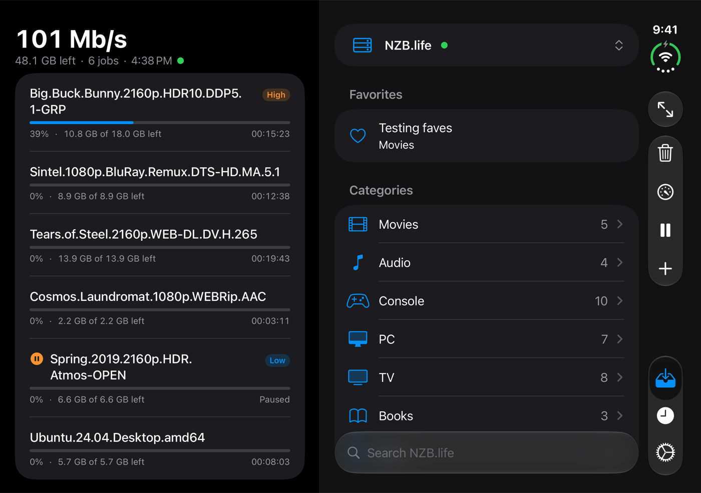
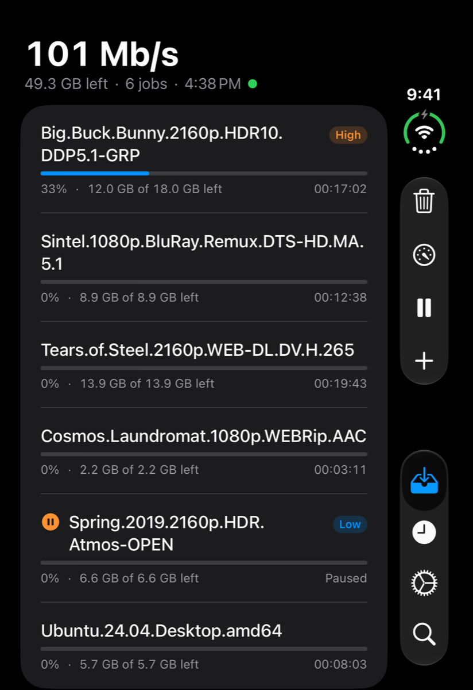
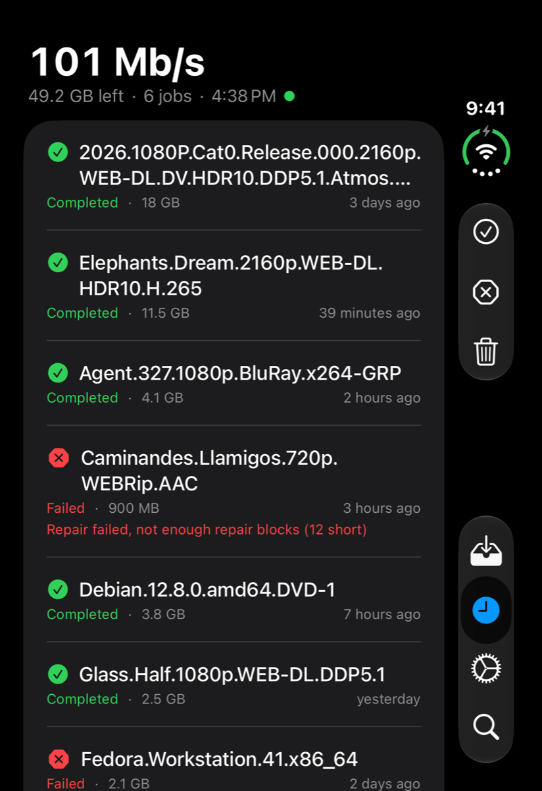
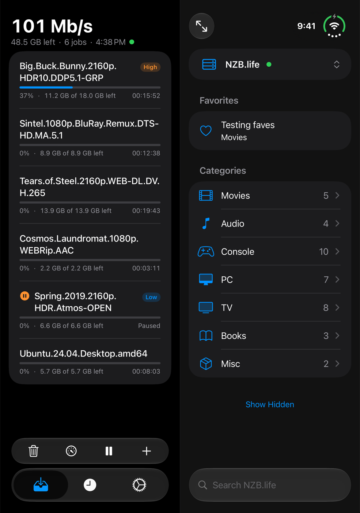

# SABduo

A SwiftUI client for [SABnzbd](https://sabnzbd.org), with Newznab indexer search, built for the
foldable iPhone Duo. Folded, it's a single page on the cover display. Unfolded, it shows two panes:
the queue or history beside search.

<p align="center">
  
</p>

<p align="center">
  
  
  
</p>

## Features

**Queue and history**
- Live queue with speed, data left, job count and time left (as a countdown or a finish time).
- Pause and resume everything or single jobs, set a speed limit, change priority, reorder and delete jobs.
- History with retry and delete, and clearing by scope.
- Add NZBs from search, the Files app, or the share sheet.

**Indexer search**
- Search any Newznab indexer by keyword or by the indexer's own category tree. Adding one offers
  well-known indexers with their API addresses filled in, or a custom address.
- Favorite searches on the home screen. Swipe to hide or delete; press and hold to reorder.
  Hidden categories are left out of searches.
- Search is optional: without an indexer, "Hide Search" turns SABduo into a plain SABnzbd remote.
- Release details: size, posting date, full category path, and the video, HDR, audio and group read
  from the release name, alongside whatever attributes the indexer sends.
- Send a release straight to SABnzbd.

**Settings**
- SABnzbd connection (host, port, HTTPS, URL base, API key), with a connection test, system load and server warnings.
- Indexers, each with its own API key. API keys are kept in the Keychain.
- Display: appearance (System, Light or Dark), speed units (Kb/s to GB/s), and the time-left style.

## Layouts

| Posture | Layout |
| --- | --- |
| Folded | One page, with the pages in a side rail. |
| Unfolded portrait | Two panes split at the fold, with the tab bar at the bottom of the list pane. |
| Unfolded landscape | Two panes of equal usable width beside the side rail. |
| Book mode (partly open) | Two panes split at the fold; the rail takes its room from the right pane. |

The layout follows the hinge through `onHingeChange` (iOS 27.1).

## Connecting to SABnzbd

SABduo only uses plain HTTP on your local network: `.local` names, single-word host names, and
local IP addresses. Anything reached over the internet needs HTTPS, so your API key never crosses
the internet unencrypted. A host that needs HTTPS gets an error saying so.

To reach SABnzbd away from home, a VPN such as [Tailscale](https://tailscale.com) is the
recommended way:

- With MagicDNS, use the machine's short name (`nas`, say) with HTTPS off. A single-word name
  counts as local.
- Or give it HTTPS with [`tailscale serve`](https://tailscale.com/kb/1312/serve) and use the full
  `nas.your-tailnet.ts.net` name with HTTPS on.

On an iPhone, the first connection to your local network asks for permission. Tap **Allow**, or
SABduo can't reach a server at home.

## Requirements

- Xcode 27 and the iOS 27 SDK. The deployment target is iOS 27.0; hinge-aware layouts need iOS 27.1.
- A SABnzbd server you can reach from the phone (see above), and its API key.
- Optionally, a Newznab indexer account and its API key.

## Building

Open `SABduo.xcodeproj`, choose the SABduo scheme and an iPhone Duo device or simulator, and run.
There are no third-party dependencies.

## Project layout

```
SABduo/
  Model/      Queue, history, search and indexer types; release-name parsing; display settings
  Services/   SABnzbd and Newznab API clients, Keychain
  Store/      App state, polling, and search state
  Views/      Folded (CompactLayout) and unfolded (SplitLayout) layouts, and the Queue, History,
              Search and Settings screens
```
